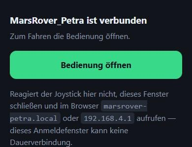
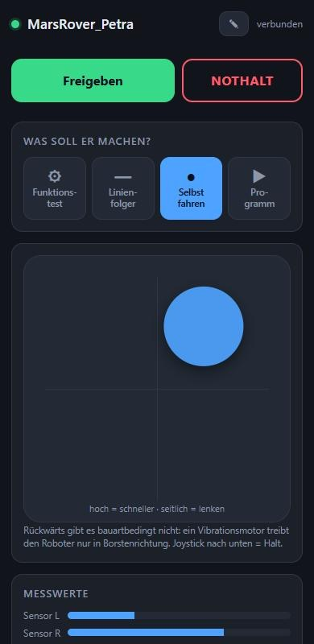
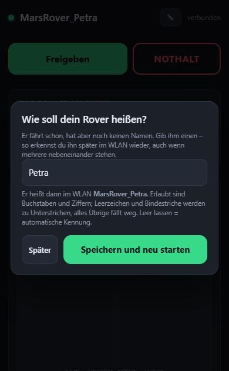
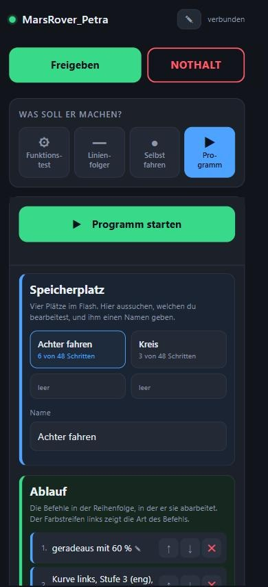
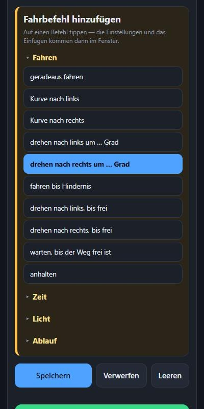
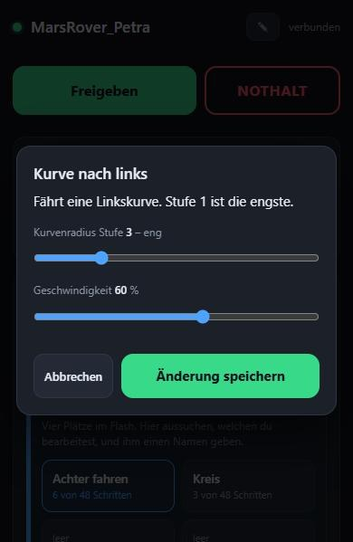

# Fernsteuerung und App

Anforderung: Steuerung muss **auf Android und iPhone** funktionieren.

---

## 1 · Warum es nicht BluetoothSerial geworden ist

`BluetoothSerial` im ESP32-Arduino-Core ist klassisches Bluetooth **SPP** (Serial
Port Profile). Apple gibt SPP auf iOS für Fremdgeräte nicht frei — dafür braucht
man eine MFi-Lizenz und einen Apple-Authentifizierungschip im Gerät. Auf Android
funktioniert SPP tadellos, auf dem iPhone grundsätzlich nicht.

Es bleiben damit genau zwei plattformübergreifende Wege: **BLE** oder **WLAN**.

| | WLAN-AP + eigene Web-App | BLE + fertige App |
|---|---|---|
| iPhone | ✅ Browser | ✅ |
| Android | ✅ Browser | ✅ |
| Installation nötig | **keine** | App aus dem Store |
| Oberfläche gestaltbar | **vollständig** | nur was die App anbietet |
| Telemetrie zurück | **beliebig** (Sensorbalken, Hz, Akku) | Textzeilen |
| Live-Tuning (Kp, Kd, Schwellen) | **ja, mit Schiebereglern** | nur über Zahleneingabe |
| Mehrverbrauch | ≈ 80 mA | ≈ 15 mA |
| Handy bleibt im Heim-WLAN | nein | ja |

**Gewählt: WLAN-AP mit eigener Web-App.** Der Mehrverbrauch kostet rund 20 %
Laufzeit, dafür gibt es eine passgenaue Oberfläche, Live-Telemetrie und
Reglerabstimmung im Betrieb — und null Installationsaufwand auf fremden Geräten.

---

## 2 · Die gebaute Web-App

Der ESP32 spannt einen eigenen Access Point auf und liefert die Oberfläche selbst
aus. Quelle: [`Firmware/MarsRover/WebUI.h`](../Firmware/MarsRover/WebUI.h),
Serverlogik in [`RemoteControl.cpp`](../Firmware/MarsRover/RemoteControl.cpp).

### Benutzung

1. Roboter einschalten.
2. Am Handy ins WLAN **`MarsRover_…`** verbinden, Passwort **`marsrover`**.
3. Es klappt ein Anmeldefenster auf mit dem Knopf **Bedienung öffnen**.
   Falls nicht: Browser öffnen und **`marsrover-petra.local`** eingeben —
   oder **`http://192.168.4.1`**.



### Warum im Anmeldefenster nicht gleich die Bedienung steht

Früher lieferte der Roboter auch dort die volle Oberfläche aus. Das sah gut
aus und war trotzdem falsch: **iOS öffnet dafür eine eingeschränkte
WebView, in der WebSockets oft nicht funktionieren.** Die Seite erschien,
der Joystick tat nichts, und es sah nach einem Fehler aus.

Jetzt kommt dort eine kleine Seite, die auch in der eingeschränkten Ansicht
zuverlässig läuft, mit einem Knopf in die richtige Bedienung — und mit dem
Hinweis, was zu tun ist, falls sie doch im Anmeldefenster hängenbleibt.

### Der Name statt der IP

Der Roboter meldet sich zusätzlich per **mDNS**, abgeleitet aus dem
Netznamen: klein geschrieben, Unterstrich zu Bindestrich.

| WLAN | Adresse im Browser |
|---|---|
| `MarsRover_Petra` | `http://marsrover-petra.local` |
| `MarsRover_A3F2` | `http://marsrover-a3f2.local` |

So ist der Name immer aus dem WLAN ableitbar, in das man gerade gegangen
ist, und zwei Rover stoßen nicht zusammen. iPhone und Mac können das von
Haus aus, Android ab Version 12 meistens; klappt es nicht, bleibt die IP.

> Auf dem iPhone meldet iOS „Kein Internet" — das ist korrekt, der Roboter
> hat keine Internetverbindung. Die Meldung bestätigen und im Netz bleiben.

> **Was nicht geht:** dem Handy vorschreiben, welche Seite sein Browser beim
> Öffnen anzeigt. Tippt man eine **`http://`**-Adresse ein, landet man beim
> Roboter — jeder DNS-Name zeigt auf ihn. Startseiten sind heute aber
> **`https://`**, und dafür bräuchte er ein gültiges Zertifikat für eine
> fremde Domain. Das wäre ein Angriff, und der Browser würde es zu Recht
> melden. Das Anmeldefenster ist der einzige Hebel.

### So sieht sie aus

Vier Bildschirmfotos sagen mehr als die Tabelle darunter. Sie stammen aus
der Vorschaufassung mit eingespeisten Beispieldaten — der Aufbau ist
derselbe, den die Firmware ausliefert.

#### Selbst fahren



Die Startansicht. Oben der Netzname des Roboters und der Statuspunkt, dann
der große Freigabeknopf — der ist **rot, solange die Motoren freigegeben
sind**, und beschriftet mit *Motoren sperren*. Darunter die Wahl der
Betriebsart, darunter das Joystickfeld: hoch ist schneller, seitlich lenkt.
Der Knopf folgt dem Finger bis an den Rand.

#### Dem Roboter einen Namen geben



Dieses Fenster klappt beim ersten Start von selbst auf, später erreicht man
es über den Stiftknopf oben rechts. Unter dem Eingabefeld steht **live
mitgerechnet**, wie das WLAN danach heißt — hier `MarsRover_Petra`.

#### Fahrprogramm zusammenstellen



Der Editor ist in drei farbige Bereiche geteilt, damit man auf dem Handy
nicht die Orientierung verliert: **blau** die Wahl des Speicherplatzes,
**grün** der Ablauf, **gelb** der Baukasten darunter. In der Schrittliste
zeigt ein Farbstreifen links die Art jedes Befehls — blau Fahren, grau
Warten, gelb Licht, violett Ablaufsteuerung. Unten der Schrittzähler.

Das kleine **✎** hinter jedem Schritt heißt: antippen und die Werte ändern.

#### Befehl aussuchen



Die Befehle sind nach **Fahren, Zeit, Licht, Ablauf** gruppiert; die
Gruppenüberschriften stehen hellgelb und fett über ihren Einträgen und
**lassen sich zuklappen**. *Fahren* steht offen, weil man die Befehle
fast immer braucht; die drei übrigen Gruppen sind zugeklappt und sparen
rund ein Drittel Scrollweg.

> **Warum keine Auswahlliste:** die Gruppenüberschriften eines `<select>`
> zeichnet das Betriebssystem. Android und iOS öffnen einen eigenen Dialog,
> der jede Formatierung der Seite ignoriert — hervorheben ließe sich dort
> nichts. Die Liste ist deshalb selbst gebaut.

#### Einstellen, einfügen, später ändern



**Ein Fenster für beides.** Tippt man in der Liste auf einen Befehl, geht
es mit *Einfügen* auf; tippt man im Ablauf auf einen vorhandenen Schritt,
mit dessen Werten und *Änderung speichern*. Darin stehen der Name des
Befehls, ein Satz dazu, was er tut, und genau die Einstellungen, die er
braucht — beim Drehbefehl also Drehwinkel **und** Geschwindigkeit, beim
Anhalten gar keine.

Zwei Dinge, die vorher fehlten:

* **Abbrechen.** Früher war ein Antippen endgültig — die Auswahl ließ sich
  nur durch eine andere ersetzen.
* **Werte nachträglich ändern.** Schritte ließen sich löschen und
  verschieben, aber eine 60 auf 25 Prozent zu korrigieren ging nur über
  Löschen und neu Einfügen.

> **Warum die Einstellungen ins Fenster gewandert sind:** 13 der 14 Befehle
> brauchen eine. Standen die Schieberegler unter der Liste, war beim
> Einstellen längst weggescrollt, *wozu* sie gehören. Im Fenster steht der
> Befehlsname darüber.

### Vier Betriebsarten statt drei

Der **Funktionstest** ist jetzt eine eigene Fläche in der Betriebsartenwahl
und steckt nicht mehr als Karte weiter unten in der Seite — dort hat ihn
niemand gesucht. Die Reihenfolge entspricht dem, was man der Reihe nach
macht: erst prüfen, dann die Linie, dann selbst fahren, dann programmieren.

| | |
|---|---|
| **Funktionstest** | Alles der Reihe nach durchprüfen |
| **Linienfolger** | Autonom der Linie folgen |
| **Selbst fahren** | Joystick |
| **Programm** | Gespeicherten Ablauf abspielen |

> **Technisch ist der Funktionstest keine Betriebsart.** In der Hauptschleife
> gilt „Diagnose geht vor Betriebsart" — der Test läuft quer zu allem
> anderen. Beim Umschalten auf diese Fläche bleibt die gefahrene
> Betriebsart deshalb, wie sie war; es wird kein `M,…` geschickt. Läuft der
> Test, springt die Ansicht von selbst dorthin.

#### Kompassrose im Funktionstest

Beim Drehtest reicht eine Gradzahl nicht: man sieht ihr nicht an, ob sich
der Rover überhaupt in die **richtige Richtung** dreht und wie weit er
schon ist. Deshalb zeigt der Funktionstest jetzt eine **Kompassrose** —
**0° oben, im Uhrzeigersinn**, genau so, wie auch der Drehwinkel in den
Fahrbefehlen gezählt wird. Die blaue Nase ist die Fahrtrichtung, die
Gradzahl steht darunter.

Der Wert kommt aus dem Feld `hd` der Telemetrie, das es ohnehin schon gab —
dafür musste an der Firmware nichts geändert werden.

#### Was beim Scrollen stehen bleibt

Zwei Leisten kleben am oberen Rand, und zwar gestapelt:

| | |
|---|---|
| **Freigeben / Motoren sperren** und **NOTHALT** | immer, in jeder Betriebsart |
| **Programm starten / stoppen** | zusätzlich, solange der Programmbereich offen ist — direkt unter der oberen Leiste |

Alles drei muss erreichbar sein, ohne vorher zu scrollen. Bei 48 Schritten
liegt das Ende der Liste über 2000 px tiefer; das ist bei einem Roboter, der
gerade vom Tisch fährt, der falsche Moment zum Wischen.

Die Startleiste klebt deshalb nicht am Fensterrand, sondern **an der
Unterkante der oberen Leiste** — sonst schöbe sie sich darunter und der
Startknopf wäre verdeckt. Deren Höhe wird beim Start gemessen und in
`--topH` hinterlegt, weil sie von Schriftgröße und Gerät abhängt und sich
nicht fest eintragen lässt.

Der **NOTHALT** ist nur umrandet, nicht gefüllt. Bei freigegebenen Motoren
heißt der Knopf daneben *Motoren sperren* und ist gefüllt rot — zwei gleich
aussehende rote Flächen nebeneinander wären im Ernstfall die falsche
Wahlhilfe.

### Was die Oberfläche kann

| Element | Funktion |
|---|---|
| Statuspunkt oben | grün = WebSocket verbunden |
| **Freigeben / Motoren sperren** | Ganz oben links. Nach dem Einschalten ist der Roboter **gesperrt**. Ohne Freigabe läuft kein Motor — verhindert, dass er beim Einschalten vom Tisch fährt |
| Funktionstest / Linienfolger / Selbst fahren / Programm | Betriebsart, **vier Flächen**. Beim Wechsel stoppen die Motoren immer erst, ein laufendes Programm wird beendet. Der Funktionstest ist in der Firmware keine Betriebsart, sondern läuft quer dazu — beim Umschalten dorthin bleibt die gefahrene Betriebsart deshalb, wie sie war |
| Joystick | hoch = schneller, seitlich = lenken. Loslassen = Stillstand. Bei Stillstand und vollem Seitenausschlag: Drehen auf der Stelle |
| Grundgeschwindigkeit | Basisvibration im Linienfolger-Modus |
| Linie kalibrieren | 5-Sekunden-Kalibrierfahrt, Werte landen im NVS-Flash |
| Programm-Editor | Vier Speicherplätze, Baukasten statt Texteingabe, Schrittzähler. Siehe [08_Fahrprogramm.md](08_Fahrprogramm.md) |
| Sensorbalken L/R, Ablage | Live-Messwerte — das wichtigste Werkzeug beim Einrichten |
| Motorbalken L/R | tatsächlich ausgegebener PWM-Duty |
| Statuszeile | Phase, Kalibrierzustand, Schleifenfrequenz, ggf. Akkuspannung |
| **Experten** (zugeklappt) | Kp, Kd, Anlaufschwelle, Kalibrierung löschen — bewusst versteckt, damit beim Ausprobieren nichts versehentlich verstellt wird |
| **NOTHALT** | Ganz oben rechts, in derselben Zeile wie die Freigabe. Sperrt sofort, stoppt ein laufendes Programm und hebt die Freigabe auf. Nur umrandet statt gefüllt, damit er nicht mit dem roten *Motoren sperren* daneben verwechselt wird |

### Gestaltungsvorgabe

Die Oberfläche ist auf **einfache Bedienbarkeit ab 14 Jahren** ausgelegt:
Klartext statt Kürzel (*„warte 2,0 Sekunden"*, nicht `wa,2000`), große
Tippflächen, Farbcodierung der Befehlsarten, und ein Baukasten, in dem
Syntaxfehler gar nicht erst entstehen können. Alles, was man zum Fahren
nicht braucht, liegt hinter dem zugeklappten Experten-Bereich.

### Technische Eckpunkte

* **Alles inline.** Kein CDN, keine Webfonts, kein externes Skript — im
  AP-Betrieb gibt es keinen Internetzugang, nachgeladene Ressourcen würden
  einfach fehlen.
* **WebSocket auf Port 81** für Steuerbefehle und Telemetrie; die Seite selbst
  kommt per HTTP von Port 80. Die App sendet mit 10 Hz, der Roboter antwortet
  mit ca. 6,7 Hz Telemetrie.
* **Totmannschalter.** Kommt im Handbetrieb länger als 500 ms kein Paket, stoppen
  die Motoren. Deckt abgeschaltetes Display, Browser im Hintergrund,
  weggelaufene WLAN-Verbindung und geschlossenen Tab ab.
* **Captive Portal per DNS.** Ein DNS-Server auf Port 53 löst jeden Namen auf
  192.168.4.1 auf, und der Webserver antwortet auf *jede* URL mit der App. Damit
  schlägt die Portalerkennung von iOS (`captive.apple.com`) und Android
  (`/generate_204`) an und das Bedienfenster öffnet sich selbst.
* **iOS-Safari-Eigenheiten berücksichtigt:** Pointer Events statt Touch Events,
  `touch-action: none` auf dem Joystickfeld, `overscroll-behavior: none` gegen
  das Gummiband-Scrollen, `gesturestart` und `dblclick` abgefangen gegen
  Pinch- und Doppeltipp-Zoom, `maximum-scale=1`.
* **Maximal 4 Clients**, Sendeleistung auf 11 dBm reduziert (spart Strom, im
  Zimmer mehr als ausreichend).

### Dem Roboter einen Namen geben

Der Rover hat keine Anzeige und keine Tasten — die Web-App ist die einzige
Stelle, an der er zu seinem Namen kommt.

**Beim ersten Start fragt die App von selbst.** Sobald sie sich verbindet und
feststellt, dass noch kein eigener Name gespeichert ist, klappt ein Fenster
auf: *„Wie soll dein Rover heißen?"* Wer das überspringen will, tippt auf
**Später** — dann bleibt es bei der automatischen Kennung aus den letzten vier
Stellen der MAC-Adresse (`MarsRover_A3F2`). Gefragt wird einmal je
Sitzung, nicht bei jedem Verbindungsabbruch.

**Später umbenennen** geht über den **Stiftknopf oben neben dem Namen** oder
über *Experten → Roboter umbenennen*. Beide öffnen dasselbe Fenster.

**Nach dem Speichern startet der Rover neu.** Das ist keine Schikane: den
WLAN-Namen vergibt der ESP32 beim Hochfahren in `softAP()`. Ohne Neustart
würde der Name zwar im Speicher stehen, das Netz aber bis zum nächsten
Einschalten noch alt heißen. Die App schickt deshalb `N|<name>` und direkt
nach der Quittung `Z`. **Danach am Handy ins neue WLAN wechseln.**

**Was aus der Eingabe wird**, zeigt das Fenster live mit: Umlaute werden
umgeschrieben (`Jürgen` → `MarsRover_Juergen`, `Groß` → `MarsRover_Gross`),
Leerzeichen und Bindestriche werden zu Unterstrichen, alles Übrige fällt
weg, und bei 16 Zeichen ist Schluss. Die Regel steht in `setApName()` in
[`RemoteControl.cpp`](../Firmware/MarsRover/RemoteControl.cpp) und ist in der
App Zeichen für Zeichen nachgebaut, damit die Vorschau nicht lügt.

> **Warum Umlaute umgeschrieben werden:** ein `ü` sind in UTF-8 zwei Bytes,
> und keines davon ist für sich genommen ein Buchstabe. Ohne die Umschrift
> fielen sie stillschweigend weg — aus `Jürgen` würde `Jrgen`.

### Passwort und SSID ändern

In [`Config.h`](../Firmware/MarsRover/Config.h):

```cpp
static const char AP_PREFIX[]   = "MarsRover";   // Netzname, MAC haengt hinten an
static const char AP_PASSWORD[] = "marsrover";   // min. 8 Zeichen!
```

WPA2 braucht mindestens 8 Zeichen. Ein leerer String gibt einen offenen AP —
dann klappt das Portal etwas zuverlässiger auf, aber jeder in Reichweite kann
den Roboter fahren.

---

## 3 · Protokoll

Textzeilen über den WebSocket, kommagetrennt. Dokumentiert, falls du später eine
native App, ein Skript oder eine Fernsteuerung mit echten Knöppen anbinden willst.

### App → Roboter

| Befehl | Bedeutung |
|---|---|
| `J,<x>,<y>` | Joystick, je −1 … +1. `y ≤ 0` heißt Halt |
| `M,0` / `M,1` / `M,2` | Betriebsart manuell / Linienfolger / Fahrprogramm |
| `A,0` / `A,1` | sperren / freigeben |
| `X` | Nothalt |
| `C` | Kalibrierfahrt starten |
| `R` | Kalibrierung löschen |
| `T,<kp>,<kd>,<base>,<min>` | Tuningwerte setzen (werden 1,5 s später ins NVS gesichert) |
| `P` | Ping, hält den Totmannschalter wach |
| `B,0` / `B,1` | Fahrprogramm stoppen / starten. Starten schaltet zugleich auf `M,2` |
| `L,<slot>` | Speicherplatz 0–3 laden, Antwort `prog` |
| `W,<slot>|<name>|<text>` | Speicherplatz schreiben, Antwort `ok` oder `err` |
| `S,0` / `S,1` | Funktionstest stoppen / starten |

Bei `W` trennt `|` die Felder, weil Name und Programmtext selbst Kommas
enthalten. Alle übrigen Befehle bleiben kommagetrennt. Ein ungültiges
Programm wird abgewiesen und **nicht** geschrieben; die Fehlermeldung nennt
den Schritt.

### Roboter → App

Eine JSON-Zeile je Telemetrieintervall:

```json
{"p":1,"m":2,"a":1,"sL":0.82,"sR":0.11,"e":-0.71,
 "dL":512,"dR":430,"dMax":613,"calOk":1,"hz":2840,
 "pr":1,"pc":7,"pn":18,"pass":1,"slot":0}
```

| Feld | Bedeutung |
|---|---|
| `p` | Phase: 0 gesperrt, 1 fährt, 2 sucht Linie, 3 Linie verloren, 4 kalibriert, 5 Akku leer, 6 wartet auf Befehl, 7 Programm beendet |
| `m` | Betriebsart (0 manuell, 1 Linienfolger, 2 Fahrprogramm) |
| `a` | freigegeben |
| `sL`, `sR` | „Linienanteil" je Sensor, 0 … 1 |
| `e` | Regelfehler, > 0 = Linie liegt rechts |
| `dL`, `dR`, `dMax` | PWM-Duty und zulässiges Maximum |
| `calOk` | Kalibrierung gültig |
| `hz` | Schleifenfrequenz — guter Gesundheitswert |
| `pr` | Fahrprogramm läuft |
| `pc`, `pn` | aktueller Schritt und Gesamtzahl — daraus die grüne Markierung in der Liste |
| `pass` | abgeschlossene Durchläufe |
| `slot` | aktiver Speicherplatz |
| `ts` | Funktionstest laeuft |
| `tp`, `tv` | Abschnitt des Funktionstests (0..7) und, bei den Motorabschnitten, die aktuelle Rampenstellung in Prozent |
| `vb` | Akkuspannung, nur mit `FEATURE_BATTERY_MONITOR` |

### Antworten außer der Telemetrie

| Typ | Wann | Inhalt |
|---|---|---|
| `cfg` | beim Verbindungsaufbau | Tuningwerte, damit die Schieberegler sofort richtig stehen |
| `slots` | beim Verbindungsaufbau und nach jedem Speichern | `a` aktiver Platz, `max` Schrittgrenze, `n[]` Namen, `c[]` belegte Schritte je Platz |
| `prog` | als Antwort auf `L` | `slot`, `name`, `p` = Programmtext |
| `ok` / `err` | nach `W` | Klartextmeldung für die Statuszeile des Editors |

---

## 4 · Fertige Apps als Rückfallebene

Falls du den WLAN-Weg doch nicht willst — etwa weil du im Betrieb im Heim-WLAN
bleiben möchtest — sind das die beiden brauchbaren Store-Apps. Beide setzen
**BLE** voraus, also einen Umbau der Firmware von WLAN auf BLE-UART
(`NimBLE-Arduino`, Nordic-UART-Service). Das Protokoll aus Abschnitt 3 kann
dabei unverändert bleiben.

| App | iOS | Android | Eignung |
|---|---|---|---|
| **Dabble** (STEMpedia) | ab iOS 11 | ja | Gamepad-Modul mit **analogem Joystick**, dazu Terminal und Regler. Nächstes Äquivalent zur gebauten Oberfläche. Es gibt eine passende Arduino-Bibliothek `DabbleESP32`, die den BLE-Teil übernimmt. **Wichtig:** die iOS-Version unterstützt ausschließlich BLE |
| **Bluefruit Connect** (Adafruit) | ab iOS 15 | ab Android 4.4 | „Controller"-Modus mit 8-Tasten-Gamepad (digital, kein analoger Joystick) plus Beschleunigungssensor. Dazu ein UART-Terminal, mit dem sich das Protokoll von Hand testen lässt — dafür auch unabhängig vom Steuerweg nützlich |

Für die reine Entwicklungsarbeit lohnt **nRF Connect** (Nordic, iOS und Android):
damit siehst du rohe BLE-Dienste und -Charakteristiken und kannst Pakete
von Hand schicken.

Einschränkung von Dabble und Bluefruit gegenüber der eigenen Web-App: Beide
bieten kein frei gestaltbares Telemetrie-Display. Die Sensorbalken und die
Live-Schieberegler für Kp/Kd müsstest du aufgeben oder in Textzeilen im
Terminal nachbilden.

---

## Quellen

- [Dabble – Bluetooth Controller im App Store](https://apps.apple.com/gb/app/dabble-bluetooth-controller/id1472734455)
- [STEMpedia/DabbleESP32 (Arduino-Bibliothek, BLE)](https://github.com/STEMpedia/DabbleESP32)
- [Dabble – Erste Schritte (STEMpedia-Doku, iOS nur BLE)](https://ai.thestempedia.com/docs/dabble-app/getting-started-with-dabble/)
- [Bluefruit Connect im App Store](https://apps.apple.com/us/app/bluefruit-connect/id830125974)
- [Adafruit Learn: Bluefruit LE Connect – Controller-Modus](https://learn.adafruit.com/introducing-the-adafruit-bluefruit-le-uart-friend/controller)

---

## 5 · Nachtrag: Sensorbefehle und Telemetriefelder

### App → Roboter

| Befehl | Bedeutung |
|---|---|
| `G` | Lagesensor nullen (Roboter dabei ruhig halten) |
| `O,<0\|1>,<mm>` | Hindernis-Stopp aus/ein und Auslöseabstand |

### Roboter → App, zusätzliche Felder

| Feld | Bedeutung |
|---|---|
| `imu` | Lagesensor gefunden |
| `hd` | Kurswinkel in Grad, relativ |
| `ic` | Nullpunkt aufgenommen |
| `dsp` | Abstandssensor gefunden |
| `ds` | Abstand in mm, 0 = nichts im Messbereich |
| `og`, `om` | Hindernis-Stopp aktiv und dessen Abstand |
| `ti` | Zusatzwert des Funktionstests: Grad bei den Drehabschnitten, mm beim Abstandsabschnitt |
| `tg`, `td` | Urteil über Lage- und Abstandssensor: 0 ungeprüft, 1 in Ordnung, 2 keine Reaktion, 3 Drehrichtung vertauscht, 4 meldet sich nicht, 5 nichts im Messbereich |

Die Phasen (`p`) sind um **9 umgekippt oder hochgehoben** und
**10 Hindernis voraus** erweitert, die Funktionstest-Abschnitte (`tp`) um
**8 Drehung rechts**, **9 Drehung links** und **10 Abstandssensor**.
