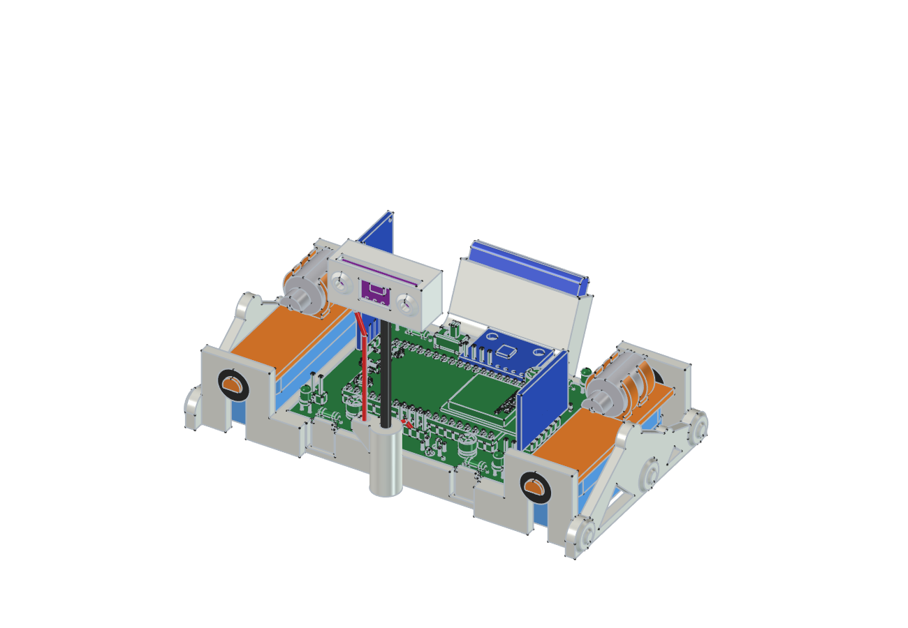
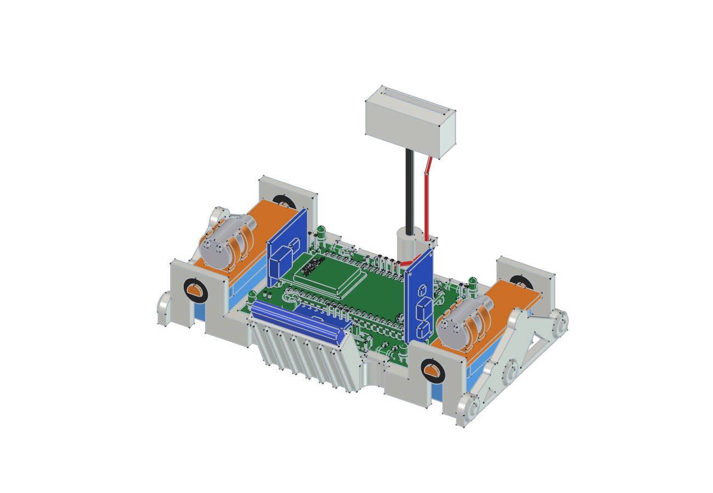
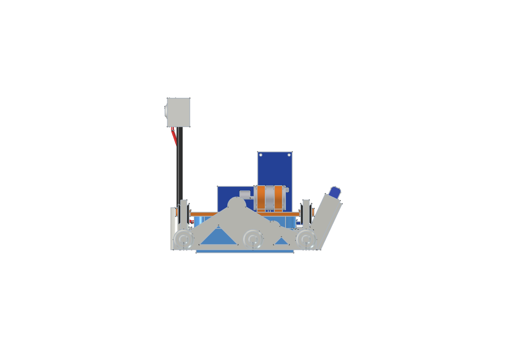
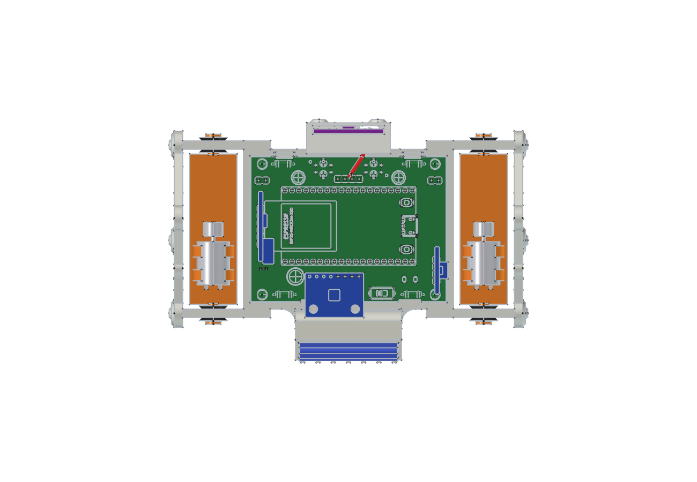
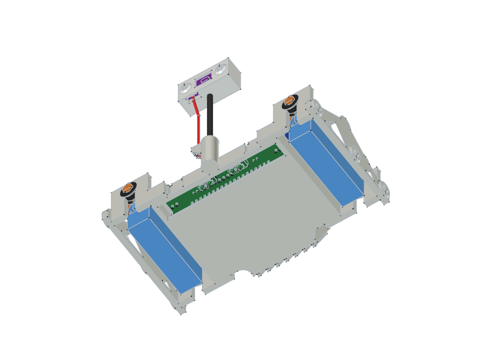

# Gehäuse und Fahrwerk

Das Gehäuse ist ein **offenes** Gestell: die Platine bleibt von oben sichtbar,
nichts wird verdeckt. Die Ähnlichkeit mit dem Mars-Rover Curiosity kommt von
drei Dingen — dem Fahrwerk an den Seiten, dem Mast mit dem „Kamerakopf" und
dem RTG am Heck.

Die CAD-Daten und die Liste der Druckteile liegen in
[Gehaeuse_CAD/](../Gehaeuse_CAD/README.md), der Zusammenbau Schritt für
Schritt in [Ich baue meinen Marsrover](Ich_baue_meinen_Marsrover.md).

> **Stand: Entwurf V2, noch nicht gedruckt und nicht getestet.** Die Bilder
> kommen direkt aus dem 3D-Modell.

---

## Von vorn

**Was man sieht:** vorn in der Mitte der Mast mit dem Kopf für den
Abstandssensor VL53L0X, links und rechts die beiden Antriebe. Die Platine
liegt offen in der Bodenschale; die beiden stehenden Module sind der
Laderegler und der Step-Up-Wandler.

## Von hinten

**Was man sieht:** am Heck die schräg gestellte Tasche mit den Kühlrippen.
Beim echten Curiosity sitzt dort der RTG, die Energiequelle — bei uns steckt
genau dort der Akku. Er steht 5 mm über, damit man ihn greifen kann.

Der Übergang zwischen Tasche und Gehäuse ist ausgerundet. Das macht die
Stelle steifer und lässt sich ohne Stützmaterial drucken.

## Von der Seite

**Was man sieht:** die Seitenwange in der Form des Curiosity-Fahrwerks. Oben
der Drehpunkt der Schwinge, ein Bein nach vorn zum Vorderrad, eines nach
hinten zum zweiten Drehpunkt, von dort zu zwei weiteren Rädern.

Die Räder sind **nur Zierde** und berühren den Boden nicht. Der Rover steht
auf den Borsten der beiden Zahnbürstenköpfe.

## Von oben

**Was man sieht:** wie die Platine im Gehäuse sitzt. An der hinteren langen
Kante schiebt man sie in eine Nut, an der vorderen rastet sie unter zwei
Haken ein. Die Haken sind an der Unterseite um 3° geschrägt — so hält die
Platine, lässt sich aber wieder herausnehmen.

## Von unten

**Was man sieht:** vorn ist der Boden offen, damit die beiden Liniensensoren
freie Sicht haben. Sie hängen 3 mm über der Fahrbahn. Links und rechts die
Borstenfelder.

---

## Wie die Vibration vom Rest ferngehalten wird

Jeder Antrieb ist ein eigenes kleines Teil: ein **Bürstenträger** mit dem
Zahnbürstenkopf unten und dem Vibrationsmotor oben. Er hängt nur an zwei
Zapfen — und jeder Zapfen steckt in einer **weichen Tülle aus TPU**.

Starren Kontakt zwischen Antrieb und Gehäuse gibt es nicht; rundum bleiben
mindestens 1,7 mm Luft. Das hat zwei Gründe:

- **Der Motor soll die Bürste schütteln, nicht den ganzen Rover.** Müsste er
  die Platine und den Akku mitbewegen, bliebe für die Borsten weniger übrig.
- **Die beiden Seiten sollen sich nicht gegenseitig stören.** Der Rover lenkt
  dadurch, dass eine Seite stärker vibriert als die andere. Wandert die
  Vibration durchs Gehäuse auf die andere Seite, verschwindet der Unterschied.

Die Unwucht des Motors sitzt genau über der Mitte der Bürste. So drückt die
Kraft gleichmäßig auf das ganze Borstenfeld.

**Beim Einbau wichtig:** beide Motoren gleich herum einsetzen und bei einem
die beiden Litzen vertauschen. Dann drehen sie gegenläufig, und der Rover
driftet nicht zur Seite.

---

## Schwerpunkt

Der Akku ist mit 10 g das schwerste Einzelteil und sitzt jetzt hinter der
Platine statt darunter. Gerechnet wandert der Schwerpunkt dadurch etwa 4 mm
nach hinten und 1,5 mm nach oben. Die Borstenfelder sind 50 mm lang; der
Schwerpunkt bleibt gut 20 mm vom hinteren Rand der Auflage entfernt. Kippen
kann der Rover davon nicht.

Angenommen sind dabei: Elektronik 24 g, Motoren je 6 g, Bürsten je 2 g,
Akku 10 g. Gewogen ist noch nichts.
