# Ich baue meinen Marsrover

Eine Anleitung Schritt für Schritt: erst die Platine löten, dann das Gehäuse
zusammensetzen, zum Schluss alles verkabeln.

> **Bitte vorher lesen:** Diese Anleitung ist am 3D-Modell entstanden. Der
> Rover ist in dieser Form **noch nicht real gebaut worden** — es kann also
> sein, dass an einer Stelle etwas klemmt oder nachgearbeitet werden muss.
> Die Bilder kommen direkt aus dem Modell. **Orange** ist immer das, was in
> diesem Schritt neu dazukommt.

---

## Was du brauchst

**Werkzeug**

- Lötkolben mit feiner Spitze, Lötzinn
- Seitenschneider, kleine Zange, Pinzette
- Multimeter
- doppelseitiges Schaumklebeband, ein Tropfen Sekundenkleber

**Teile**

- die Platine — die kleinen SMD-Bauteile sind schon drauf
- die bedrahteten Bauteile aus der [Stückliste](03_Stueckliste-BOM.md)
- ESP32 DevKitC V4, die Module MPU-6050, VL53L0X, TP4056 und MT3608
- 2 Vibrationsmotoren, 2 Zahnbürstenköpfe, Akku 503035
- CFK-Rundstab Ø 3 mm, 70 mm lang
- 4 dünne Litzen, je etwa 9 cm (für den Sensor im Mast)
- die Druckteile aus [Gehaeuse_CAD](../Gehaeuse_CAD/README.md): 1 Bodenschale,
  2 Bürstenträger, 1 Mastkopf, 4 Tüllen aus TPU

**Drei Regeln fürs Löten**

1. **Erst die flachen Teile, dann die hohen.** Sonst liegt die Platine beim
   Löten nicht mehr flach.
2. **Auf die Richtung achten.** Dioden, LEDs und Elkos funktionieren nur
   richtig herum. Der Aufdruck auf der Platine zeigt, wie.
3. **Drähte nach dem Löten kurz abschneiden** — höchstens 2 mm stehen lassen.

---

# Teil 1 · Die Platine bestücken

## Schritt 1 — Die Platine ansehen

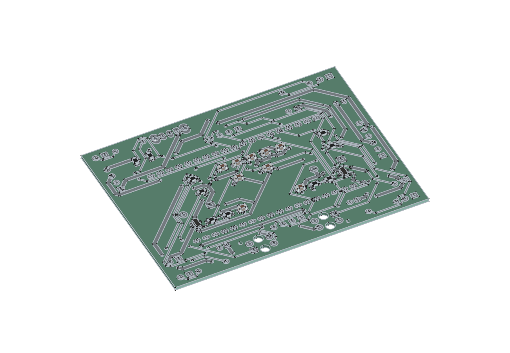

So sieht die Platine am Anfang aus. Die winzigen Bauteile sind schon
aufgelötet. Lege dir die Platine so hin, dass du den Aufdruck lesen kannst,
und suche die Namen der Bauteile: `R9`, `D1`, `LED1` und so weiter.

## Schritt 2 — Widerstände und Dioden

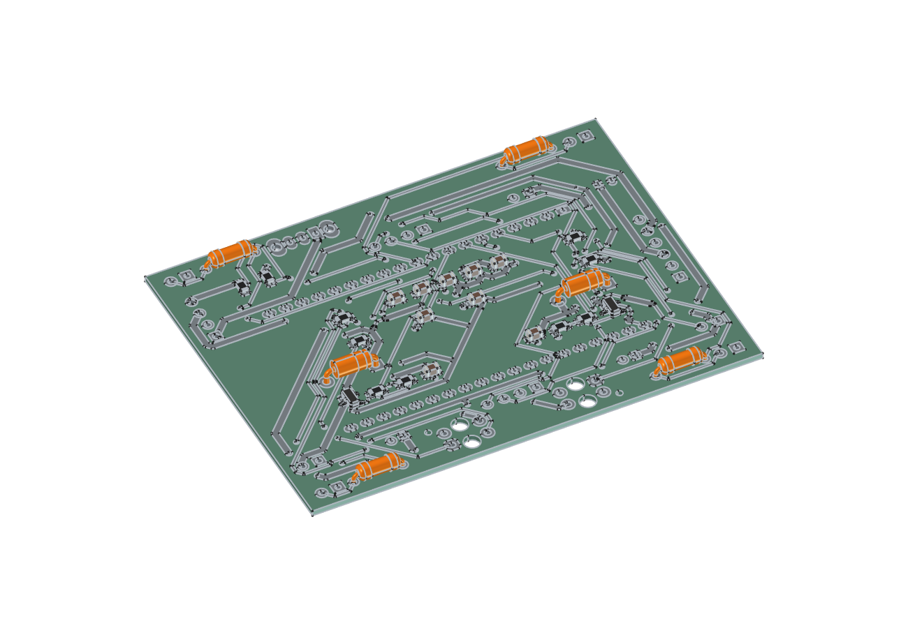

| Bauteil | Platz | Achte auf |
|---|---|---|
| 4 Widerstände 220 Ω | `R9`, `R10`, `R11`, `R12` | Richtung ist egal |
| 2 Dioden 1N5819 | `D1`, `D2` | **Der Ring auf der Diode muss zum Strich im Aufdruck zeigen** |

Beine umbiegen, durchstecken, Platine umdrehen, löten, Drähte abschneiden.

## Schritt 3 — Die Unterseite: Liniensensoren und Akkustecker

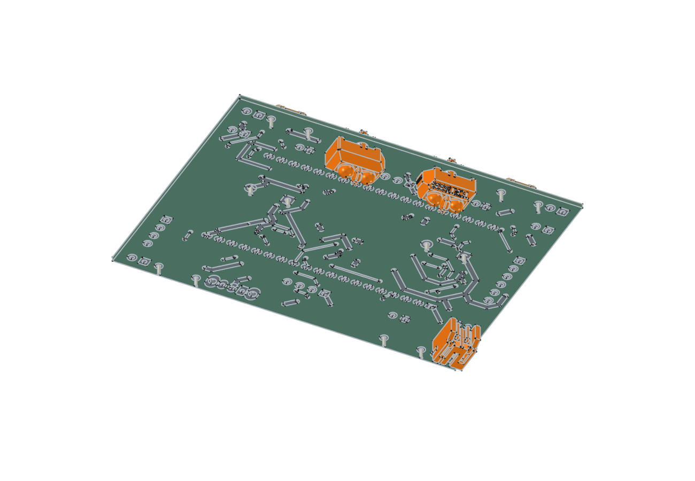

Jetzt die Platine **umdrehen**. Diese drei Teile sitzen auf der Unterseite
und werden von der Oberseite her gelötet.

| Bauteil | Platz | Achte auf |
|---|---|---|
| 2 Liniensensoren TCRT5000 | `OS1`, `OS2` | Die abgeschrägte Ecke gehört dorthin, wo sie der Aufdruck zeigt. **Die beiden Sensoren sitzen gegeneinander verdreht** |
| 1 Akkustecker JST-PH, liegend | `J2` | So herum, wie der Aufdruck es zeigt |

Die Sensoren müssen ganz flach aufliegen und beide gleich hoch sein. Sonst
sieht der eine die Linie besser als der andere.

## Schritt 4 — Stiftleisten und Buchsenleisten

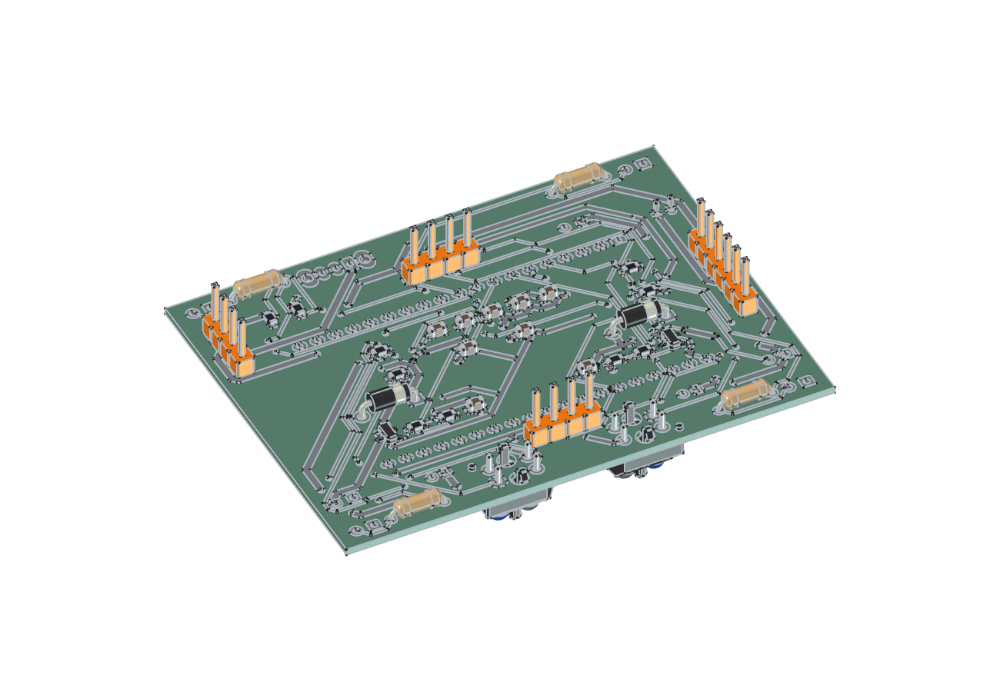

| Bauteil | Platz | Wofür |
|---|---|---|
| Stiftleiste 6-polig | `U2` | Laderegler |
| Stiftleiste 4-polig | `U5` | Step-Up-Wandler |
| Stiftleiste 4-polig | `U6` | Lagesensor |
| Stiftleiste 4-polig | `U7` | Kabel zum Sensor im Mast |
| 2 Buchsenleisten 19-polig | `U1` | Hier wird später der ESP32 eingesteckt |

**Tipp für gerade Leisten:** erst nur einen Stift anlöten, prüfen, ob die
Leiste senkrecht steht, dann den Rest.

Die beiden Plätze `M1` und `M2` bleiben frei. Dort kommen später die Litzen
der Motoren hinein.

## Schritt 5 — Schalter und LEDs

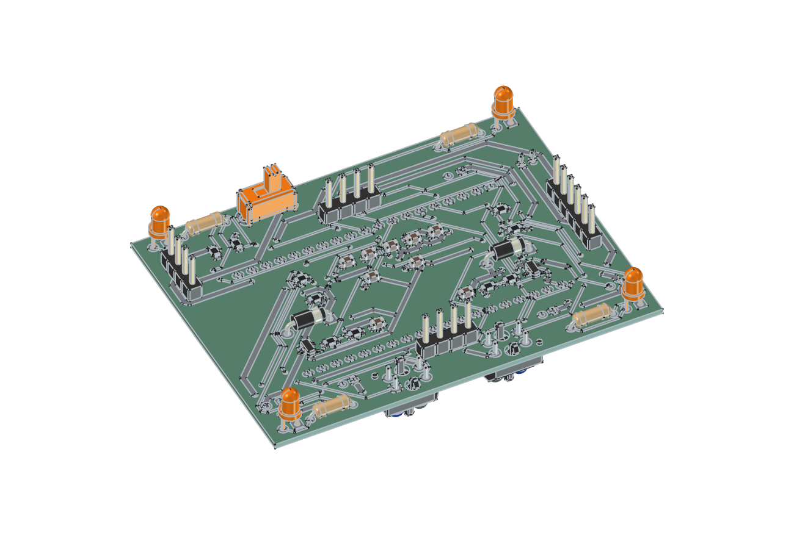

| Bauteil | Platz | Achte auf |
|---|---|---|
| Schiebeschalter | `S1` | Richtung ist egal |
| 2 LEDs gelb | `LED1`, `LED2` (vorn) | **Das lange Bein ist Plus.** Die flache Seite am Gehäuse der LED zeigt zur flachen Seite im Aufdruck |
| 2 LEDs rot | `LED3`, `LED4` (hinten) | wie oben |

## Schritt 6 — Die Elkos

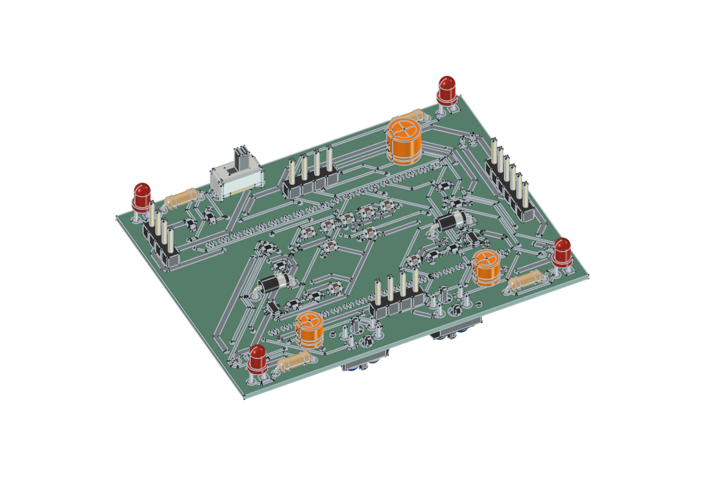

| Bauteil | Platz | Achte auf |
|---|---|---|
| 2 Elkos 47 µF | `C11`, `C12` | **Der helle Streifen auf dem Elko ist Minus.** Plus ist im Aufdruck mit `+` markiert |
| 1 Elko 100 µF | `C1` | wie oben |

Ein falsch herum eingelöteter Elko geht kaputt, sobald Strom fließt. Lieber
zweimal hinsehen.

## Schritt 7 — Die Module vorbereiten

Bevor die Module auf die Platine kommen, müssen zwei von ihnen umgebaut
werden. Das geht nur, solange sie noch lose auf dem Tisch liegen.

- **MT3608 (Step-Up-Wandler):** Das kleine Drehpoti auslöten und durch zwei
  feste Widerstände ersetzen (110 kΩ und 15 kΩ). Danach im Leerlauf
  nachmessen: am Ausgang müssen **5,0 V** anliegen. Die genaue Beschreibung
  steht in [Inbetriebnahme, Schritt 1a](07_Inbetriebnahme-und-Tuning.md).
- **TP4056 (Laderegler):** Den Widerstand für den Ladestrom gegen 4,7 kΩ
  tauschen, sonst wird der kleine Akku zu schnell geladen.

> **Achtung beim Laderegler:** Es gibt ihn mit und ohne Schutzschaltung. Die
> Platine ist für ein Modul **mit** Schutzschaltung und sechs Anschlüssen
> gedacht. Hat dein Modul nur vier Anschlüsse (`IN+`, `IN−`, `BAT+`,
> `BAT−`), dann gilt:
>
> - `BAT+` kommt an Pin 3 von `U2`, `BAT−` an Pin 4.
> - **Pin 3 und Pin 5 von `U2` mit einem Drahtstück verbinden.** Ohne diese
>   Brücke bekommt der Rover keinen Strom.
> - Der Akku muss dann eine **eigene Schutzplatine** haben (meist unter dem
>   gelben Klebeband am Kabelende). Sonst kann er tiefentladen werden.
>
> Die ganze Belegung steht in der
> [Pinbelegung](05_Pinbelegung.md#modulanschlüsse-auf-der-platine).

## Schritt 8 — ESP32 einstecken

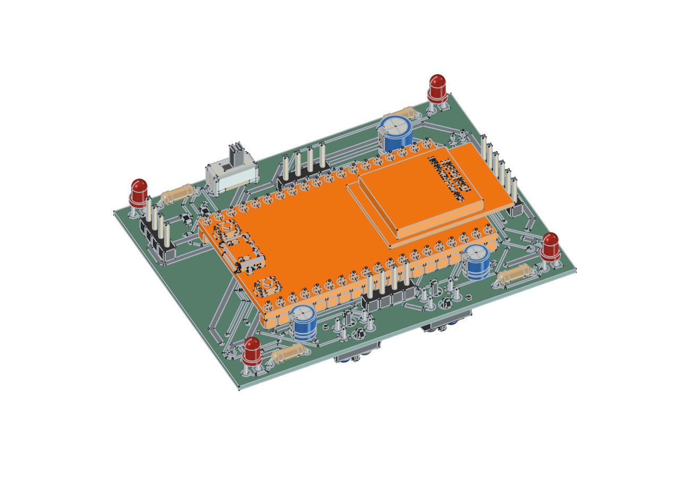

Den ESP32 in die beiden Buchsenleisten stecken. Die Antenne (das Ende mit
dem Metalldeckel) zeigt zu der Seite, an der `U2` sitzt, der USB-Anschluss
zur anderen. Gleichmäßig drücken, nicht verkanten.

## Schritt 9 — Die Module aufsetzen

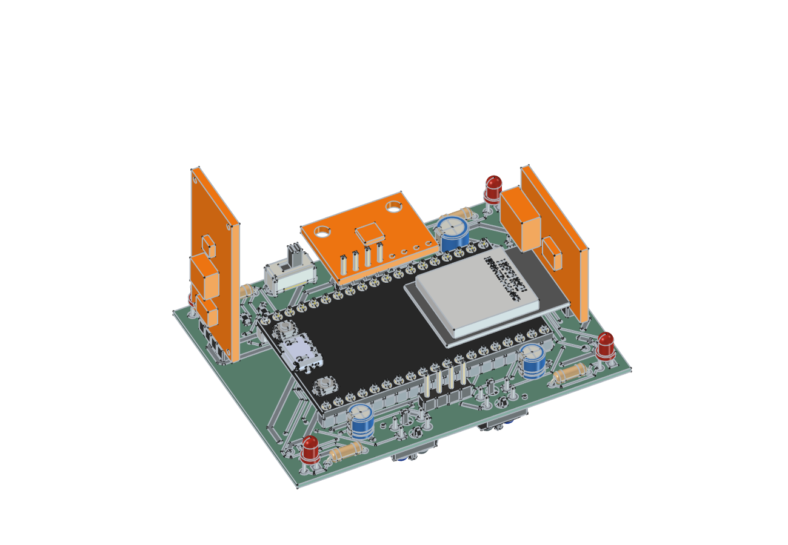

| Modul | Platz | So sitzt es |
|---|---|---|
| TP4056 | `U2` | steht senkrecht am Rand |
| MT3608 | `U5` | steht senkrecht am Rand, **darf den USB-Anschluss des ESP32 nicht verdecken**. Seine vier Lötaugen sitzen an den Ecken — zwei davon mit kurzen Drahtstücken zur Leiste führen |
| MPU-6050 | `U6` | liegt flach, ragt nach hinten über den Platinenrand |

Die Module werden auf die Stiftleisten gesetzt und verlötet. Der Lagesensor
soll fest sitzen und nicht wackeln — genau dieses Wackeln würde er sonst
messen.

**Die Platine ist jetzt fertig.** Bevor sie ins Gehäuse kommt: einmal mit dem
Multimeter prüfen, ob zwischen Plus und Minus kein Kurzschluss ist.

---

# Teil 2 · Das Gehäuse zusammensetzen

## Schritt 10 — Die Bodenschale

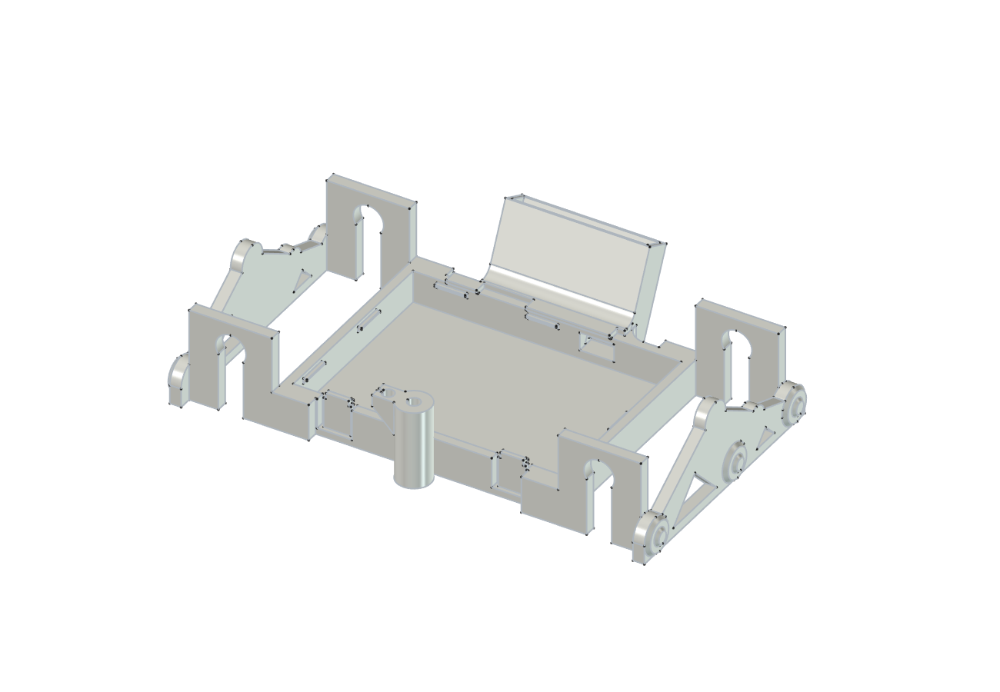

Das ist das Hauptteil. Sieh dir an, was wo ist:

- **vorn** der runde Mastfuß mit der kleinen Kabelöse daneben
- **hinten** die schräge Tasche mit den Rippen — dort kommt der Akku hinein
- **links und rechts** das Fahrwerk mit je zwei Gabeln, die nach unten offen sind
- **innen vorn** zwei Rasthaken, **innen hinten** eine Nut

Reste vom Druck entfernen. Die beiden Rasthaken vorsichtig mit dem Finger
nach außen drücken: sie müssen federn.

## Schritt 11 — Zwei Antriebe bauen

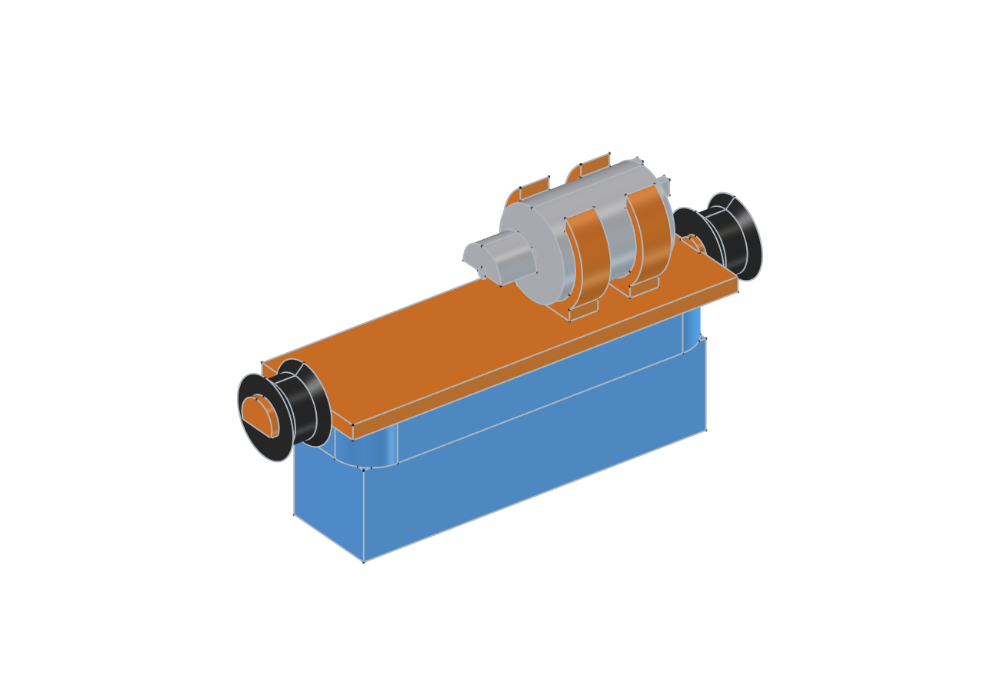

Das machst du zweimal, einmal für links und einmal für rechts.

1. **Bürstenkopf ankleben.** Ein Stück Schaumklebeband auf die glatte Seite
   des Bürstenkopfs, dann mittig unter den Bürstenträger drücken. Die Borsten
   zeigen nach unten.
2. **Motor einklipsen.** Den Motor von oben in die beiden Schellen drücken.
   Das kleine Gewicht an der Welle (die Unwucht) zeigt nach **vorn** und
   sitzt genau über der Mitte der Bürste. Es muss sich frei drehen können.
3. **Tüllen aufstecken.** Auf jeden der beiden Zapfen eine schwarze Tülle
   schieben, bis sie hinter dem Kopf des Zapfens sitzt.

**Wichtig:** Beide Motoren gleich herum einsetzen — bei beiden zeigt die
Unwucht nach vorn.

## Schritt 12 — Die Antriebe einklipsen

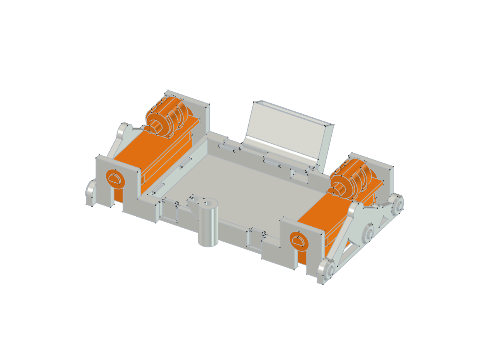

Die Bodenschale umdrehen. Einen Antrieb von unten so ansetzen, dass beide
Tüllen vor den Gabeln liegen, und dann hineindrücken, bis die Tüllen
einrasten. Dasselbe auf der anderen Seite.

Probe: Der Antrieb darf das Gehäuse nirgends berühren. Er hängt nur in den
beiden weichen Tüllen und lässt sich leicht hin und her bewegen.

---

# Teil 3 · Einbauen und verkabeln

## Schritt 13 — Motoren anlöten

Solange die Platine noch draußen ist, die Litzen der beiden Motoren in die
Löcher bei `M1` (links) und `M2` (rechts) löten. Die Litzen so lang lassen,
dass sie in einem lockeren Bogen zum Motor laufen — ein straffes Kabel würde
die Vibration aufs Gehäuse übertragen.

**Bei einem der beiden Motoren die zwei Litzen vertauschen.** Dann drehen
die Motoren gegenläufig, und der Rover läuft geradeaus statt zur Seite.

## Schritt 14 — Die Platine lose einlegen

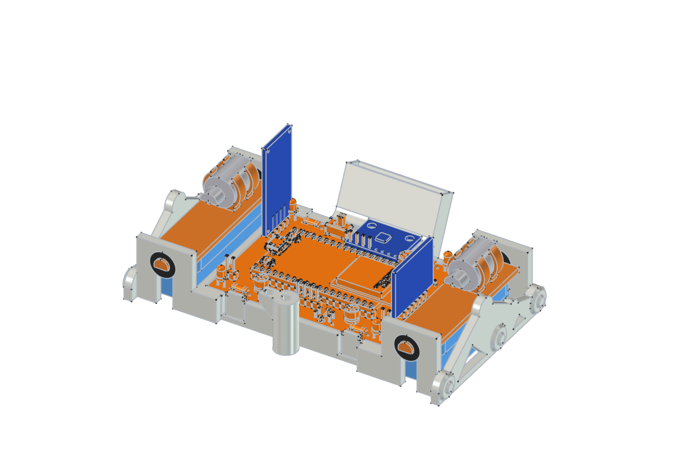

Die Platine schräg halten und mit der **hinteren** langen Kante unter die
Nut schieben. Vorn nur auflegen, **noch nicht einrasten** — sie muss gleich
noch einmal angehoben werden.

Der Akku ist noch nicht angeschlossen. Das bleibt so, bis alles gelötet ist.

## Schritt 15 — Mast und Abstandssensor

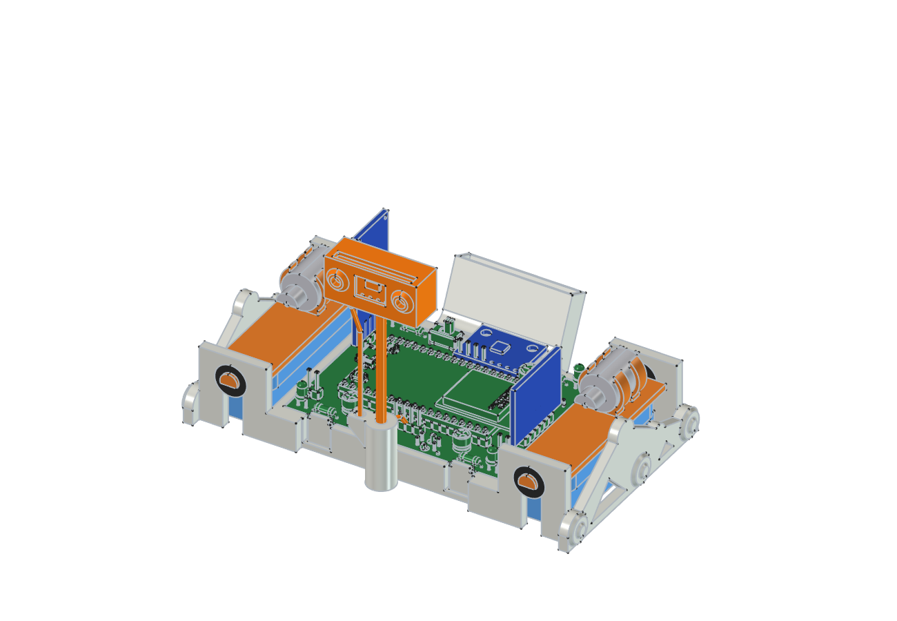

Der Sensor VL53L0X braucht vier Leitungen: `VIN`, `GND`, `SCL` und `SDA`.

1. **Litzen an den Sensor löten.** Vier Litzen von etwa 9 cm in die Lötaugen
   `VIN`, `GND`, `SCL` und `SDA` des Moduls löten. Am besten vier
   verschiedene Farben nehmen und aufschreiben, welche wohin gehört. Die
   Lötaugen `XSHUT` und `GPIO1` bleiben frei.
2. **Sensor in den Mastkopf.** Das Modul von oben in den Schlitz schieben —
   die Lötaugen nach unten, der kleine schwarze Sensor schaut nach vorn
   durch das Fenster. Die Litzen kommen unten aus dem Kabelauslass.
3. **Mast einstecken.** Den CFK-Stab mit einem Tropfen Kleber in den Mastfuß
   stecken, dann den Mastkopf oben aufsetzen. Der Kopf schaut geradeaus nach
   vorn, **nicht nach unten** — sonst misst er die Tischplatte.
4. **Kabel führen.** Die vier Litzen leicht verdrillen und am Mast entlang
   nach unten führen. Unten seitlich in die geschlitzte **Kabelöse** drücken.
5. **Schlaufe lassen.** Zwischen Öse und Platine einen kleinen Bogen lassen.
   Der Mast schwingt beim Fahren; ohne Schlaufe bricht das Kabel an der
   Lötstelle.
6. **An `U7` anschließen.** Die vier Litzen an die Stiftleiste `U7` löten.
   Pin 1 ist das **eckige** Lötauge:

   | Pin an `U7` | Litze vom Sensor |
   |---|---|
   | 1 | `VIN` |
   | 2 | `GND` |
   | 3 | `SCL` |
   | 4 | `SDA` |

## Schritt 16 — Akkukabel anstecken, Platine einrasten

Ab jetzt wird nicht mehr gelötet. Den Schalter `S1` auf **Aus** stellen.

1. **Kabel durchfädeln.** Den Stecker des Akkus von hinten durch das kleine
   Fenster unten links an der Akkutasche in die Bodenschale fädeln. Den Akku
   selbst noch nicht einschieben.
2. **Polung prüfen.** Plus am Akkustecker muss zu Plus im Aufdruck bei `J2`
   passen. Die Stecker sind nicht genormt. **Falsch herum geht der
   Laderegler sofort kaputt.**
3. **Anstecken.** Die Platine vorn anheben und den Stecker in `J2` auf der
   Unterseite stecken.
4. **Einrasten.** Die vordere Kante der Platine nach unten drücken, bis
   beide Haken hörbar einrasten.

Die Platine liegt jetzt ringsum auf kleinen Auflagen. Kein Kabel darf
darunter eingeklemmt sein.

**Wieder herausnehmen:** beide Haken vorn leicht nach außen drücken und die
Platine vorn anheben.

## Schritt 17 — Akku einsetzen

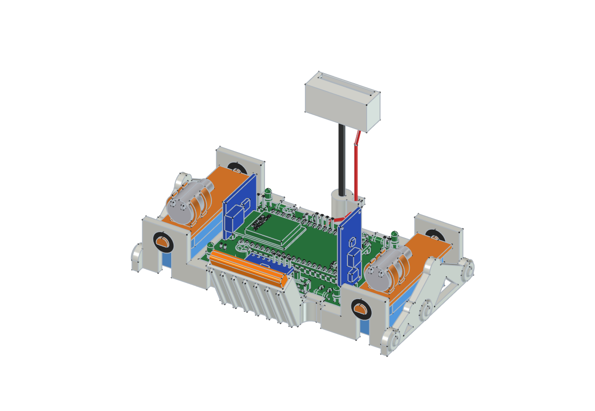

Den Akku von oben in die schräge Tasche am Heck schieben, das Kabel nach
unten. Er steht etwa 5 mm über — daran kannst du ihn wieder herausziehen.

Sitzt er zu locker, ein kleines Stück Schaumklebeband in die Tasche kleben.

## Fertig!

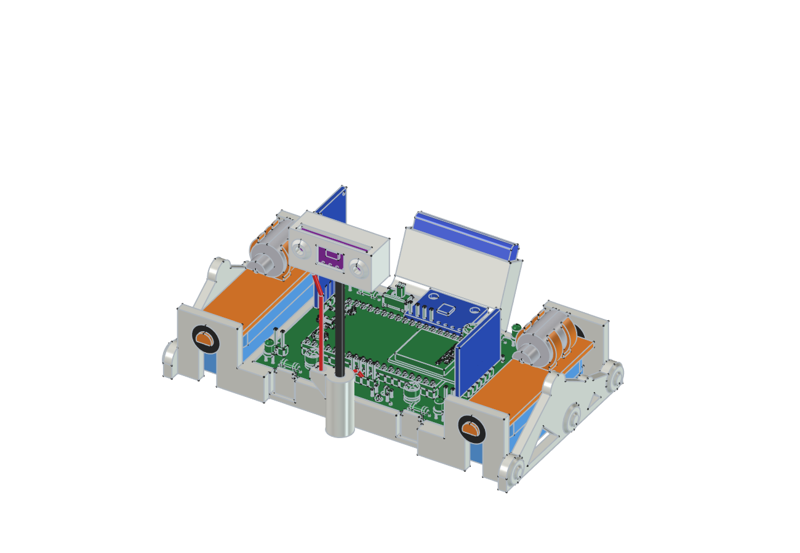

Zum Schluss noch einmal prüfen:

- [ ] Beide Antriebe hängen frei und berühren das Gehäuse nicht
- [ ] Die beiden Unwuchten können sich frei drehen
- [ ] Die Liniensensoren unten sind frei und sauber
- [ ] Kein Kabel liegt auf einer Unwucht oder unter der Platine
- [ ] Der Mastkopf schaut waagerecht nach vorn

Jetzt den Schalter `S1` einschalten. Wie es weitergeht — Firmware
aufspielen, mit dem Handy verbinden, Sensoren einstellen — steht in
[Inbetriebnahme und Tuning](07_Inbetriebnahme-und-Tuning.md).
