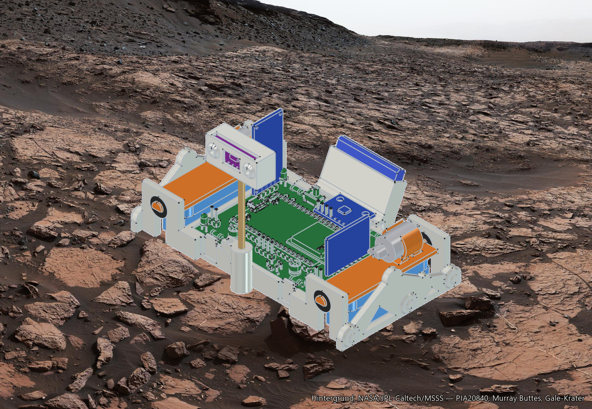

# Gehäuse und Fahrwerk (CAD)

3D-Daten für das Gehäuse des Mars Rovers: eine offene Bodenschale, in die die
Platine eingeclipst wird, ein Fahrwerk im Stil von Curiosity und ein Mast für
den Abstandssensor. Bilder und Erklärung stehen in
[Doku/11](../Doku/11_Gehaeuse-und-Fahrwerk.md), der Zusammenbau in
[Ich baue meinen Marsrover](../Doku/Ich_baue_meinen_Marsrover.md).

> **Stand: Entwurf V2, noch nicht gedruckt und nicht getestet.** Alle
> Prüfungen sind bisher rechnerisch am Modell gemacht. Einige Maße der
> Zukaufteile sind Katalogwerte, siehe [Annahmen](#annahmen-und-offene-punkte).

*Montage: CAD-Modell freigestellt, Hintergrund NASA/JPL-Caltech/MSSS, PIA20840
(Murray Buttes, Gale-Krater).*

---

## Druckteile

| Druckteil | Stück | Lage auf der Druckplatte | Material | Schicht | Wandlinien | Infill | Gewicht massiv |
|---|---|---|---|---|---|---|---|
| `Bodenschale` | 1 | Boden nach unten, so wie sie später steht | PETG | 0,2 mm | 3 | 15 % | 34 g |
| `Buerstentraeger_L` | 1 | Trägerplatte flach nach unten, Motorschellen nach oben | PETG | 0,2 mm | 4 | 100 % | 3,0 g |
| `Buerstentraeger_R` | 1 | wie links | PETG | 0,2 mm | 4 | 100 % | 3,0 g |
| `Mastkopf` | 1 | aufrecht, Mastbohrung nach unten, Schlitz nach oben offen | PETG | 0,2 mm | 2 | 10 % | 4,5 g |
| `Tuelle_TPU_L1` | **4** | stehend, Bohrung senkrecht | TPU, weich (85A–95A) | 0,2 mm | 2 | 15 % | 0,3 g |

Größen: Bodenschale 129 × 85 × 28 mm, Bürstenträger 17 × 68 × 15 mm,
Mastkopf 30 × 12 × 14 mm, Tülle Ø 10,4 × 5,4 mm.

**Zusammen massiv etwa 46 g.** Das Gewicht ist aus dem Volumen gerechnet
(PETG 1,27 g/cm³, TPU 1,21 g/cm³) und damit die **Obergrenze**. Mit den
Einstellungen aus der Tabelle wird es leichter; den echten Wert zeigt der
Slicer.

### Wird mit Infill gedruckt?

Ja, aber es spielt eine kleinere Rolle, als man denkt. Die meisten Wände
sind 1,2 bis 3 mm dick — bei 3 Wandlinien mit einer 0,4-mm-Düse sind sie
damit **ohnehin voll**. Infill entsteht nur an den wenigen dicken Stellen:
im Übergang zur Akkutasche, im Mastfuß und im Inneren des Mastkopfs.

- **Bodenschale: 15 %.** Mehr bringt keine Festigkeit an den Stellen, auf
  die es ankommt (Haken, Nut, Gabeln sind reine Wand), kostet aber Gewicht.
- **Bürstenträger: 100 %.** Sie sind klein, und die Zapfen (Ø 4 mm) und
  Motorschellen müssen halten. Mit 4 Wandlinien sind sie praktisch massiv.
- **Mastkopf: 10 %.** Er sitzt ganz oben am Mast; jedes Gramm dort lässt
  den Mast stärker schwingen.
- **Tüllen: 2 Wandlinien, 15 %.** Hier ist weich besser als fest — sie
  sollen die Vibration schlucken.

### Einstellungen für PETG

| | |
|---|---|
| Düse | 0,4 mm |
| Schichthöhe | 0,2 mm (erste Schicht 0,2–0,25 mm) |
| Linienbreite | 0,4–0,45 mm |
| Boden- und Deckschichten | 4 (= 0,8 mm) |
| Infill-Muster | Gyroid |
| Düsentemperatur | 235–245 °C |
| Betttemperatur | 75–85 °C |
| Bauteillüfter | 30–50 %, erste Schicht aus |
| Geschwindigkeit Außenwand | 30–50 mm/s |
| Stützmaterial | keines |
| Haftung | Rand (Brim) nur, wenn sich die Ecken der Bodenschale heben |
| Naht | „hinten" bzw. ausgerichtet, nicht zufällig — sonst sitzen Pickel auf Haken und Tüllensitzen |

Für die **TPU-Tüllen**: 220–235 °C, Bett 40–60 °C, langsam (20–30 mm/s),
Rückzug klein oder aus.

> Das sind **Startwerte**, keine erprobten Profile: mit diesen Teilen ist
> noch nichts gedruckt worden. Filament und Drucker gehen vor — im Zweifel
> gelten die Angaben auf der Spule.
Kurz zu jedem Teil:

- **Bodenschale** — das Hauptteil. Trägt die Platine (Nut hinten, zwei
  Rasthaken vorn), die Akkutasche in Form des RTG am Heck, den Mastfuß vorn
  und an beiden Seiten das Fahrwerk mit den Gabeln für die Antriebe.
- **Bürstenträger** — je einer links und rechts. Unten klebt der
  Zahnbürstenkopf, oben klemmt der Vibrationsmotor in einer 10 mm
  breiten Schelle, gesichert mit einem Kabelbinder durch den Querkanal unter
  dem Motor. Die beiden Zapfen an den Enden stecken in den TPU-Tüllen.
- **Mastkopf** — sitzt oben auf dem Holzspieß und hält den VL53L0X. Zwei
  kegelige Pegs greifen in die Befestigungslöcher des Moduls.
- **Tüllen** — vier Stück aus weichem TPU. Sie sind die einzige Verbindung
  zwischen Antrieb und Gehäuse und halten die Vibration aus der Platine heraus.

**Stützmaterial ist nicht vorgesehen.** Die Teile sind so gebaut, dass kein
Überhang flacher als 45° ist. Übrig bleiben nur: die Unterseiten der beiden
Rasthaken (1,1 mm) und der Nut (0,5 mm), zwei kurze Brücken (Kabelfenster
9 mm, Sichtfenster im Mastkopf 10 mm) und die vier waagerechten
Tüllenbohrungen (Ø 8 mm). **PETG statt PLA**, weil die Rasthaken quer zur
Schicht federn.

---

## Was in diesem Ordner liegt

| Datei / Ordner | Inhalt |
|---|---|
| `Druckteile/` | Die Druckteile als **STL** (für den Slicer) und **STEP** (zum Weiterkonstruieren) |
| `Bauteile/` | Einfache Modelle der Zukaufteile als STEP: Motor, MPU-6050, VL53L0X, TP4056, MT3608, Akku, Bürstenkopf, Holzspieß |
| `MarsRover_Gehaeuse_V2_ohne_Bauteile.FCStd` | FreeCAD-Datei mit allen Teilen und der **nackten** Platine |
| `build_gehaeuse.py` | Erzeugt die Druckteile. Alle Maße stehen oben als Parameter |
| `build_bauteile.py` | Erzeugt die Zukaufteile und setzt sie an ihren Einbauort |
| `platine_huellkoerper.json` | Hüllkörper aller Platinenbauteile — damit wird geprüft, dass nichts anstößt |
| `V1/` | Früherer Stand: Akku unter der Platine, kürzere Bürstenköpfe. Nur zum Nachschlagen |

Die FreeCAD-Datei **mit** bestückter Platine bleibt lokal. Sie enthält
Fremdmodelle aus den KiCad- und Espressif-Bibliotheken, die nicht unsere zum
Weitergeben sind — derselbe Grund wie bei `local_Step Files/`.

### Neu erzeugen

Beide Skripte laufen in FreeCAD (getestet mit 1.1) in einem Dokument namens
`MarsRover_Gehaeuse`, erst `build_gehaeuse.py`, dann `build_bauteile.py`.
Jeder Lauf baut alles neu auf. Das Dokument muss in diesem Ordner gespeichert
sein — `build_bauteile.py` legt die STEP-Dateien neben der FreeCAD-Datei ab.

**Koordinaten:** X nach rechts (0…70), Y nach vorn (0…52), Z nach oben. Die
Unterseite der Platine liegt auf Z = 0.

---

## Die wichtigsten Maße

| | |
|---|---|
| Gesamtgröße | ca. 129 × 85 mm, Mast bis 66 mm über der Platine |
| Liniensensoren über dem Boden | 3,0 mm (Parameter `SENSOR_GAP`) |
| Bodenfreiheit der Schale | 1,5 mm |
| Bürstenkopf | 50 × 15 × 18 mm, ungekürzt |
| Akku | 503035 (30 × 35 × 5 mm), quer in der RTG-Tasche, 25° geneigt |
| Rasthaken | 2 Stück vorn, Unterseite 3° geschrägt — die Platine lässt sich wieder herausnehmen |

---

## Annahmen und offene Punkte

- **Nicht gemessen, sondern Katalogwert:** Motorkörper (Ø 12 × 15,5 mm),
  GY-521 (21 × 16 mm), TP4056 (25 × 19 mm). Vom Bürstenkopf ist die
  Gesamthöhe gemessen; die Aufteilung in 6 mm Platte und 12 mm Borsten ist
  angenommen.
- **Einbaulage von MPU-6050, TP4056 und MT3608 ist angenommen.** Zwischen
  der RTG-Tasche und dem MPU-6050 bleiben im Modell nur 0,4 mm.
- **Das gekaufte TP4056-Modul** (Mini-USB) hat laut Händler **keine
  Schutzschaltung** — die Projektdoku rechnet mit einem Modul mit Schutz.
- **Akkutasche ohne Verriegelung.** Der Akku hält durch Neigung und Reibung.
- **Gewicht.** Mit Elektronik, Motoren und Akku kommt der Rover gerechnet auf
  76–92 g. Die Projektdoku nennt schon 40 g als Risiko für den
  Vibrationsantrieb. Das ist die erste Stelle zum Abspecken.
